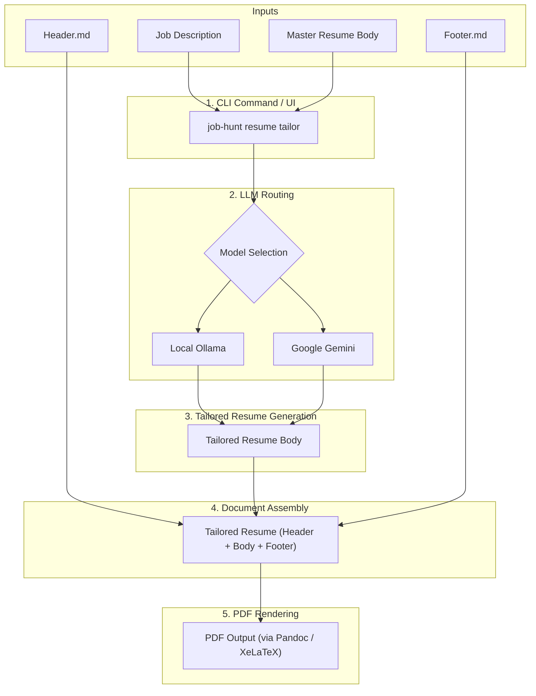

# Job Hunt & Resume Tailoring Workspace

Welcome to the **Job Hunt & Resume Tailoring Workspace**, an integrated Python ecosystem designed to automate, optimize, and benchmark your job application lifecycle.

This repository provides tools to scrape job listings, evaluate role compatibility with local/cloud LLMs, parse and validate Markdown Resume schemas, tailor resumes for ATS platforms, and benchmark LLM outputs.

---

## Repository Structure Overview

The project follows a standard Python package layout under `src/job_hunt/` with isolated unit and integration test suites:

```
job-hunt/
├── pyproject.toml               # Package definition & job-hunt CLI entry point
├── justfile                     # Centralized workspace command runner
├── src/
│   └── job_hunt/                # Core Python package namespace
│       ├── cli.py               # Main CLI application router (`job-hunt`)
│       ├── config/              # Centralized YAML configuration manager
│       ├── core/                # LLM clients (Ollama/Gemini/Pydantic AI), telemetry
│       ├── resume/              # Resume parser, tailoring logic, PDF renderer
│       ├── job_finder/          # Indeed/LinkedIn/Stepstone scrapers & match reviewer
│       ├── eval/                # Benchmark & evaluation framework engines
│       └── ui/                  # Streamlit web composer interface
├── tests/
│   ├── unit/                    # Fast unit test suite
│   └── integration/             # Browser & live LLM integration tests
├── data/                        # Sample CV templates & sample inputs
└── workspace/                   # Gitignored working directory for generated outputs
```

---

## Running Commands from Outside the Repository (e.g. from `/tmp`)

You can run the `job-hunt` CLI from any directory on your system (e.g., inside `/tmp` or another project workspace):

### Option 1: Installed Package Entrypoint (Recommended for CLI use)
Install the package in editable mode:

```bash
# Inside repository root
uv pip install -e .
```

Once installed, `job-hunt` is available globally in your environment PATH:

```bash
# Executing from /tmp (or any directory)
cd /tmp
job-hunt resume check ./draft_cv.md
job-hunt resume tailor --resume ~/master_resume.md --jd ./jd_tesla.txt --output ./tailored_resume.pdf
job-hunt finder review --jd ./jd_tesla.txt
```

### Option 2: `uv run` with `--directory`
If you prefer not to install the CLI to global PATH, execute via `uv run`:

```bash
# Executing from /tmp via uv run
cd /tmp
uv run --directory /path/to/job-hunt job-hunt resume check ./draft_cv.md
uv run --directory /path/to/job-hunt job-hunt resume tailor --resume ~/master_resume.md --jd ./jd_tesla.txt --output ./tailored_resume.pdf
```

---

## Workspace Quick Commands (via `just`)

All development tasks can be run directly from the repository root using `just`:

```bash
# Install dependencies and package in editable mode
just install

# Run any CLI subcommand with arbitrary arguments
just run resume check data/example_resume/body.md
just run resume tailor --resume data/example_resume/body.md --jd data/job_tesla.txt -o workspace/outputs/tailored.md
just run finder fetch
just run ui

# Run unit tests
just test

# Run integration tests
just test-integration

# Code quality and formatting
just lint
```

---

## Architecture & Data Flow


